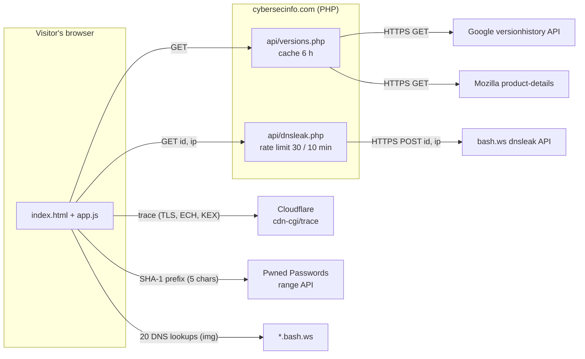

# PC Check — Browser, Connection, DNS & Password Security

**▶ Live:** [cybersecinfo.com/pccheck](https://cybersecinfo.com/pccheck/) · part of [CyberSecInfo](https://cybersecinfo.com)

**Four security checks that run in the visitor's own browser, with nothing to install, nothing stored and a live log of every byte that leaves the device.**


PC Check is being built in stages. This first stage checks what a web page can honestly see from the browser. The next stage adds diagnostics from reports the operating system already produces (crash history, battery, system info), still with nothing to install.

| Check | What it tells you | How |
|---|---|---|
| **Outdated browser** | Whether your browser is behind the latest release | The version is read locally and compared with the latest Chrome (per platform) and Firefox/ESR versions published by Google and Mozilla |
| **Secure connection** | TLS version, Encrypted Client Hello, post-quantum key exchange | Cloudflare's public `cdn-cgi/trace` endpoint. TLS 1.2 here often means an antivirus or proxy is inspecting your HTTPS |
| **DNS leak** | Which DNS servers really resolve your lookups | The browser looks up 20 one-off names under `bash.ws`; the free bash.ws service reports which resolvers asked |
| **Leaked password** | Whether a password appears in known breaches | Have I Been Pwned's Pwned Passwords range API with k-anonymity: only the first 5 characters of the SHA-1 hash leave the device |

The page is in English and works in light and dark mode, down to 375 px wide.

## Privacy model

- **Nothing leaves the device before you click.** No request is made on page load beyond the page's own files.
- **Outbound log.** Every request is listed on screen as it happens: destination, purpose and the exact data sent.
- **k-anonymity for passwords.** The password is hashed in the browser; the Pwned Passwords API receives only a 5-character prefix and returns hundreds of matching suffixes (padded with fake ones, `Add-Padding: true`). The comparison happens locally. The input is cleared right after submit and the full hash is never shown.
- **No cookies, no analytics, no third-party scripts, no browser storage.**
- **The server keeps nothing personal.** The PHP proxy stores no IPs, no test IDs, no results. The rate limiter keeps only a salted SHA-256 of the IP for a 10-minute window.

## Architecture



The browser talks to Cloudflare and Pwned Passwords directly (both send CORS headers). Google, Mozilla and bash.ws are reached through two small PHP endpoints, because they either lack CORS or need a server-side call.

## Security decisions

- **Strict Content Security Policy** (`default-src 'none'`, scripts, styles and fonts from `'self'` only, `connect-src` limited to the three services, `frame-ancestors 'none'`). No inline scripts or styles; no `innerHTML` with outside data.
- **Hardened PHP proxy** (`api/_lib.php`):
  - GET only (405 otherwise); strict input validation (`id` must match `^[1-9][0-9]{8}$`, `ip` must be a public IP).
  - Outbound calls are HTTPS-only (`CURLPROTO_HTTPS`), certificate verified, redirects off, 9-second timeout, 1 MB response cap.
  - Upstream answers are reduced to the minimum fields, IPs re-validated, control characters stripped, text length and server count capped.
  - Per-IP sliding-window rate limit with `flock`, 429 + `Retry-After`.
  - `_lib.php` and the cache folder are denied by `.htaccess` and also refuse direct execution.
- **Response headers:** `nosniff`, `Referrer-Policy: no-referrer`, `X-Frame-Options: DENY`, restrictive `Permissions-Policy`.
- **Old-browser friendly:** `app.js` is written in ES2017 on purpose, so outdated browsers can still run the page and be told they are outdated.

## Honest limitations

- The DNS test depends on the free bash.ws service; if it is down, the check says so.
- TLS is measured on the connection to Cloudflare, not to every site you visit.
- Safari and iOS browsers update with the operating system, so their version cannot be compared from a web page; the check gives guidance instead.
- A password that was **not** found in breaches is not necessarily strong; it is just not in the known lists.
- A VPN, ad blocker or corporate network can block some checks; each one then shows "Couldn't check" instead of a guess.

## Tests

From `tests/` (needs PHP 7.4+ with cURL and Node 18+):

```bash
npm install                               # Playwright
npx playwright install chromium
node --check ../assets/app.js && for f in ../api/*.php; do php -l "$f"; done
php php/parsers_test.php                  # parsers with real and hostile upstream fixtures
php php/ratelimit_test.php                # sliding window, IPs never stored in clear
node api/run.mjs                          # endpoints on php -S (BSC_LIVE=1 also hits Google/Mozilla)
node e2e/run.mjs                          # Playwright: every outside service mocked with page.route
```

The end-to-end suite checks that nothing leaves before the click, that the password `password` produces only `/range/5BAA6`, that each failing service shows "Couldn't check" without breaking the page, that the outbound log renders every request, that the page stays English-only even for a Portuguese browser, and takes screenshots in light, dark and 375 px with no horizontal scroll and a visible keyboard focus.

## Deploy (Hostinger or any Apache + PHP host)

Requirements: PHP 7.4+ with cURL (falls back to `file_get_contents` with TLS verification), Apache with `mod_headers` for the security headers.

Upload `index.html`, `.htaccess`, `assets/` and `api/` (with `api/cache/.htaccess`) to `public_html/pccheck/`. Leave out `tests/`, `README.md`, `LICENSE` and `HANDOFF.md`. Make sure `api/cache/` is writable by PHP.

## Credits

- [Pwned Passwords](https://haveibeenpwned.com/Passwords) by Troy Hunt (Have I Been Pwned), CC BY 4.0
- [Cloudflare](https://www.cloudflare.com/) `cdn-cgi/trace`
- [bash.ws](https://bash.ws/) DNS leak test ([terms](https://bash.ws/terms)), integration modelled on their official plugin [macvk/wp-vpn-leak-tests](https://github.com/macvk/wp-vpn-leak-tests)
- [Google Chrome version history API](https://developer.chrome.com/docs/web-platform/versionhistory/guide) and [Mozilla product-details](https://product-details.mozilla.org/1.0/)
- Fonts (self-hosted, SIL Open Font License 1.1): [Orbitron](https://fonts.google.com/specimen/Orbitron) and [Roboto](https://fonts.google.com/specimen/Roboto) (`assets/fonts/OFL-orbitron.txt`, `OFL-roboto.txt`), [Atkinson Hyperlegible Mono](https://www.brailleinstitute.org/freefont/) by the Braille Institute (`OFL-mono.txt`)

## License

MIT, see [LICENSE](LICENSE).
